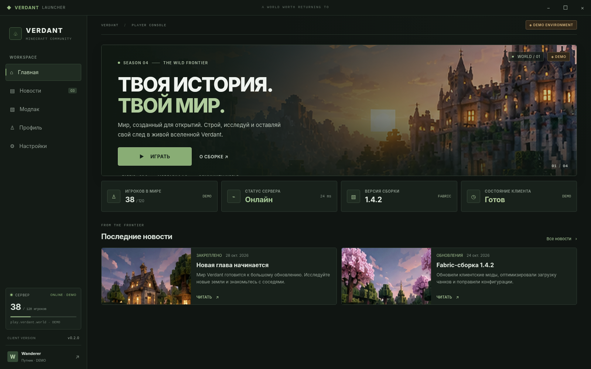
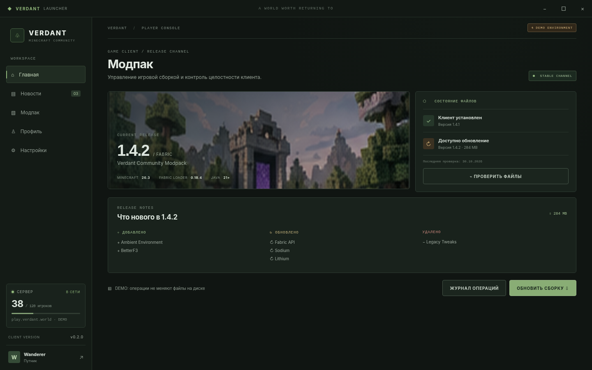
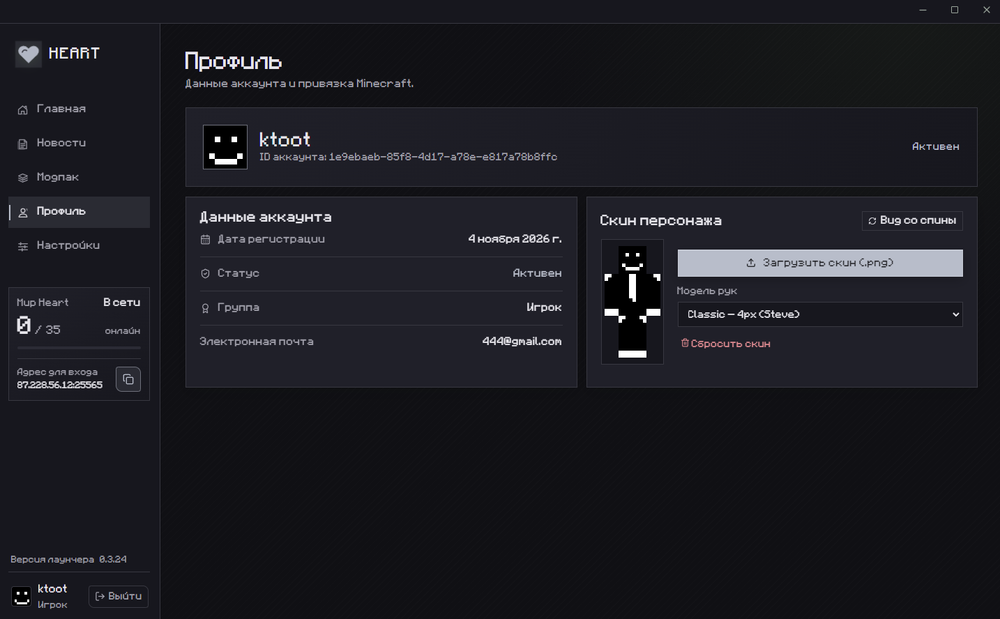
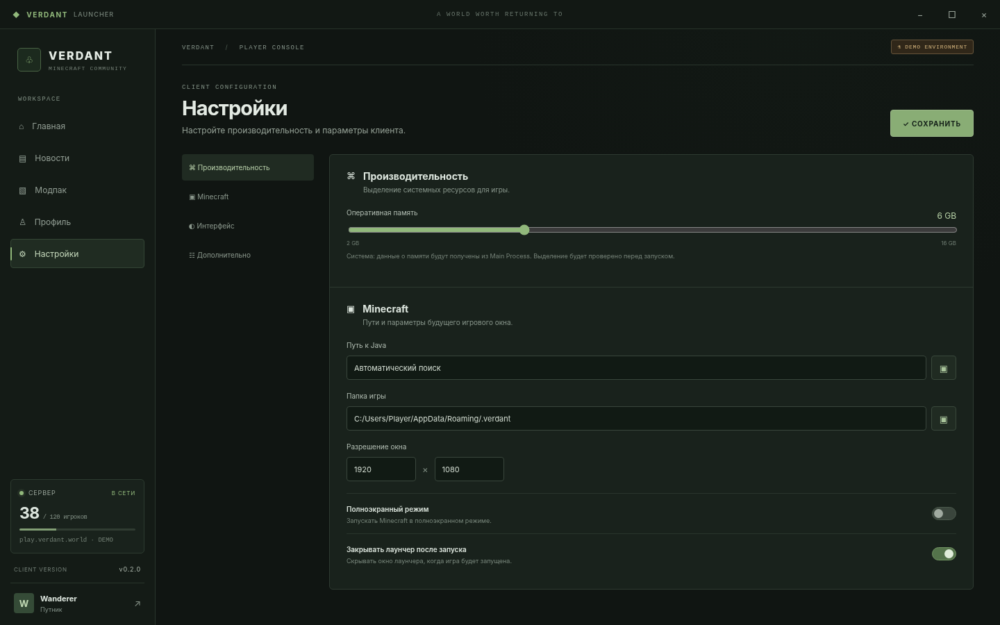

<p align="center">
  
</p>

<h1 align="center">Heart Minecraft Launcher</h1>

<p align="center">
  <strong>Современный, легковесный кастомный лаунчер для Minecraft Java Edition с Fabric-клиентом.</strong>
</p>

<p align="center">
  
  
  
  
  
</p>

<p align="center">
  <a href="#-особенности">Особенности</a> •
  <a href="#-быстрый-старт-для-игроков">Скачать</a> •
  <a href="#-скриншоты">Скриншоты</a> •
  <a href="#-для-разработчиков">Разработка</a> •
  <a href="#-архитектура">Архитектура</a>
</p>

---

##  Особенности

*  **Мгновенный старт:** Автоматическая установка портативной **Java 21**, клиента **Minecraft 1.21.11** и **Fabric Loader 0.19.5** в один клик.
*  **Автообновление:** Лаунчер автоматически проверяет наличие новых версий на GitHub Releases и обновляется в фоне.
*  **Умная синхронизация модов (HeartBridge):** Скачивание и актуализация сборки клиентских модов и ресурс-паков напрямую с сервера и Modrinth с валидацией хешей SHA-1 / SHA-512.
*  **Кастомные скины прямо в лаунчере:** Поддержка скинов (Classic 4px и Slim 3px) и плащей с предпросмотром модели персонажа в реальном времени.
*  **Heart Identity Link:** Безопасный беспарольный вход на сервер через генерацию одноразовых сессионных грантов.
*  **5 уникальных тем оформления:** Heart, Obsidian, Crimson, Ocean, Amethyst + поддержка кастомного пиксельного шрифта *Minecraft Rus*.
*  **Низкое потребление памяти:** Оптимизированный Electron runtime с жестким контролем фоновых процессов и кэшированием ассетов.

---

##  Скриншоты

<table align="center">
  <tr>
    <td align="center"><strong>Главный экран</strong></td>
    <td align="center"><strong>Управление сборкой</strong></td>
  </tr>
  <tr>
    <td></td>
    <td></td>
  </tr>
  <tr>
    <td align="center"><strong>Гардероб скинов</strong></td>
    <td align="center"><strong>Настройки клиента</strong></td>
  </tr>
  <tr>
    <td></td>
    <td></td>
  </tr>
</table>

---

## 📥 Быстрый старт (для игроков)

1. Перейдите во вкладку **[Releases](https://github.com/barsik-ru/Heart_launcher/releases)**.
2. Скачайте последний установщик **`Heart-Launcher-Setup-x.x.x.exe`**.
3. Запустите установщик, выберите папку и нажмите «Установить».
4. Запустите Heart Launcher, введите ваш никнейм и нажмите **«Скачать и играть»**!

---

## 🛠️ Для разработчиков

### Требования
* **Node.js** 22 LTS (или новее)
* **npm** 10+
* **ОС:** Windows 10/11 (целевая платформа сборщика NSIS)
*         Linux 

### Установка и запуск

```bash
# Клонирование репозитория
git clone https://github.com/barsik-ru/Heart_launcher.git
cd Heart_launcher

# Установка зависимостей
npm install

# Запуск в режиме разработки
npm run dev
